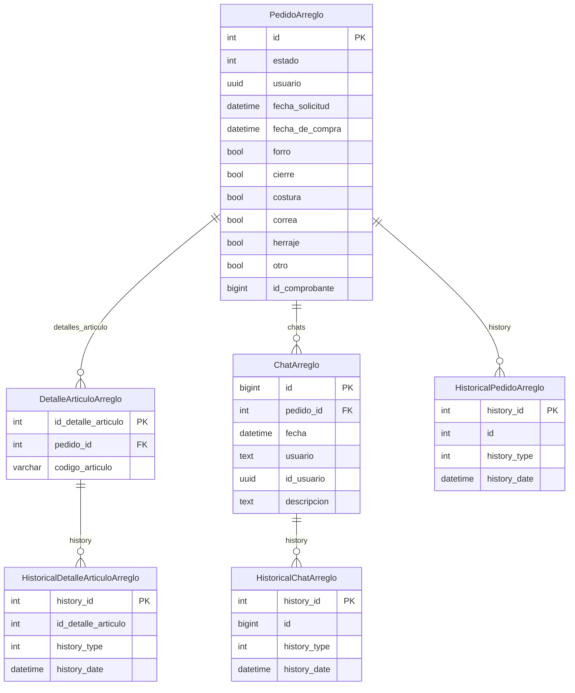

# Módulo `arreglos`

> **US #974 — F2: Modelos de pedidos de reparación**

## Propósito

El módulo `arreglos` gestiona los pedidos de reparación de artículos (carteras, etc.) que los clientes traen al local. Opera sobre tablas legacy de SQL Server (`xlsales`) con acceso de lectura y escritura vía ORM Django, sin modificar el esquema existente. El historial de cambios se almacena en PostgreSQL (`default`) mediante `django-simple-history`.

---

## Modelos

### `EstadoArreglo` (`IntegerChoices`)

Enumeración de los 10 estados del flujo de reparación, mapeada al campo `Estado` (`int`) de la tabla `Pedidoes`.

| Valor | Nombre          | Label                        |
|-------|-----------------|------------------------------|
| 0     | BORRADOR        | Borrador                     |
| 1     | ENVIADO         | Enviado                      |
| 2     | FABRICA         | En Fábrica                   |
| 3     | REPARACION      | En Reparación                |
| 4     | REPARADOS       | Reparados                    |
| 5     | TERMINADO_R     | Terminado (Reparación)       |
| 6     | FINALIZADO      | Finalizado                   |
| 7     | IMPORTE_A_FAVOR | Importe a Favor              |
| 8     | NC_OTORGADA     | NC Otorgada                  |
| 9     | TERMINADO_IAF   | Terminado (Importe a Favor)  |

### `PedidoArreglo` (managed=False → `xlsales.Pedidoes`)

Pedido principal de reparación. Tabla `Pedidoes` en SQL Server.

- PK: `id` (AutoField, `db_column="Id"`)
- Campo login: `estado` (IntegerField con `EstadoArreglo.choices`)
- 6 BooleanFields (`forro`, `cierre`, `costura`, `correa`, `herraje`, `otro`) con `default=False` — necesario porque SQL Server define estas columnas como `BIT NOT NULL`.
- `autorizo_decision` mapea al typo original de SS: `db_column="AutorizoDesicion"` — **no corregir** sin DDL en SQL Server.
- `history = HistoricalRecords()` — tabla `HistoricalPedidoArreglo` en PostgreSQL.
- Ordenamiento por defecto: `["-id"]`.

Mapeo completo de columnas

| Campo Django               | Columna SQL Server          | Tipo            |
|----------------------------|-----------------------------|-----------------|
| `id`                       | `Id`                        | AutoField (PK)  |
| `estado`                   | `Estado`                    | IntegerField    |
| `usuario`                  | `Usuario`                   | UUIDField?      |
| `bolsin`                   | `Bolsin`                    | TextField?      |
| `bolsin_egreso`            | `BolsinEgreso`              | TextField?      |
| `fecha_solicitud`          | `FechaSolicitud`            | DateTimeField   |
| `fecha_de_compra`          | `FechaDeCompra`             | DateTimeField   |
| `ingreso_a_fabrica`        | `IngresoAFabrica`           | DateTimeField?  |
| `fecha_egreso`             | `FechaEgreso`               | DateTimeField?  |
| `box_deposito`             | `BoxDeposito`               | DateTimeField?  |
| `numero_de_orden_de_reparacion` | `NumeroDeOrdenDeReparacion` | TextField?  |
| `cliente`                  | `Cliente`                   | TextField?      |
| `email`                    | `Email`                     | TextField?      |
| `telefono`                 | `Telefono`                  | TextField?      |
| `articulo`                 | `Articulo`                  | TextField?      |
| `descripcion`              | `Descripcion`               | TextField?      |
| `observaciones`            | `Observaciones`             | TextField?      |
| `recibido`                 | `Recibido`                  | TextField?      |
| `encargado_que_autorizo`   | `EncargadoQueAutorizo`      | TextField?      |
| `entrego`                  | `Entrego`                   | TextField?      |
| `recibio`                  | `Recibio`                   | TextField?      |
| `diferencias_encontradas`  | `DiferenciasEncontradas`    | TextField?      |
| `forro`                    | `Forro`                     | BooleanField    |
| `cierre`                   | `Cierre`                    | BooleanField    |
| `costura`                  | `Costura`                   | BooleanField    |
| `correa`                   | `Correa`                    | BooleanField    |
| `herraje`                  | `Herraje`                   | BooleanField    |
| `otro`                     | `Otro`                      | BooleanField    |
| `txt_forro`                | `txtForro`                  | TextField?      |
| `txt_cierre`               | `txtCierre`                 | TextField?      |
| `txt_costura`              | `txtCostura`                | TextField?      |
| `txt_correa`               | `txtCorrea`                 | TextField?      |
| `txt_herraje`              | `txtHerraje`                | TextField?      |
| `txt_otro`                 | `txtOtro`                   | TextField?      |
| `decision`                 | `Decision`                  | TextField?      |
| `autorizo_decision`        | `AutorizoDesicion`          | TextField? ⚠️ typo en SS |
| `nombre_de_usuario`        | `NombreDeUsuario`           | TextField?      |
| `ingreso_a_box`            | `IngresoABox`               | DateTimeField?  |
| `id_comprobante`           | `IdComprobante`             | BigIntegerField |
| `ultima_modificacion`      | `UltimaModificacion`        | UUIDField?      |
| `comprobante_importe_a_favor` | `ComprobanteImporteAFavor` | CharField?    |

### `DetalleArticuloArreglo` (managed=False → `xlsales.DetalleArticulo`)

Ítems de artículo asociados a un pedido. Tabla `DetalleArticulo` en SQL Server.

- PK: `id_detalle_articulo` (AutoField, `db_column="IdDetalleArticulo"`)
- FK a `PedidoArreglo` (`db_column="IdPedido"`, `on_delete=PROTECT`, `db_constraint=False`)
- `codigo_articulo` (`db_column="CodigoArticulo"`)
- `history = HistoricalRecords()`
- Ordenamiento: `["id_detalle_articulo"]`.

### `ChatArreglo` (managed=False → `xlsales.Chats`)

Mensajes de chat interno asociados a un pedido. Tabla `Chats` en SQL Server.

- PK: `id` (BigAutoField, `db_column="Id"`)
- FK a `PedidoArreglo` (`db_column="IdPedido"`, `on_delete=PROTECT`, `db_constraint=False`)
- `fecha` (DateTimeField, `db_column="Fecha"`)
- `usuario` / `id_usuario` (texto e UUID del usuario)
- `history = HistoricalRecords()`
- Ordenamiento: `["fecha"]`.

---

## Diagrama ERD

---

## Routing de bases de datos

`XlsalesRouter` ([`core/db_router.py`](../../core/db_router.py)):

| Modelo                          | `managed` | Base de datos    |
|---------------------------------|-----------|------------------|
| `PedidoArreglo`                 | False     | `xlsales` (SS)   |
| `DetalleArticuloArreglo`        | False     | `xlsales` (SS)   |
| `ChatArreglo`                   | False     | `xlsales` (SS)   |
| `HistoricalPedidoArreglo`       | True      | `default` (PG)   |
| `HistoricalDetalleArticuloArreglo` | True   | `default` (PG)   |
| `HistoricalChatArreglo`         | True      | `default` (PG)   |

La migración `0001_initial.py` solo crea las tres tablas `Historical*` en PostgreSQL. Los modelos `managed=False` son state-only (no-op en `migrate`).

---

## Decisiones de diseño

### `managed=False` — sin cambios de esquema en SQL Server

Las tres tablas (`Pedidoes`, `DetalleArticulo`, `Chats`) pertenecen al sistema .NET legacy. Django las mapea para lectura/escritura ORM pero nunca modifica su estructura. Agregar campos como `created_at` o heredar `TimeStampedModel` causaría errores de "Invalid column name" en producción.

### `on_delete=PROTECT` + `db_constraint=False` en FKs

- `db_constraint=False`: no genera `FOREIGN KEY` en SQL Server (evita romper escrituras del lado .NET que no respetan el orden de inserción que Django esperaría).
- `on_delete=PROTECT`: si el ORM Django intenta borrar un `PedidoArreglo` que tiene detalles o chats, lanza `ProtectedError` antes de ejecutar el `DELETE`. Esto protege la integridad desde el lado Django.
- **Caveat importante:** el sistema .NET puede borrar pedidos sin pasar por el ORM Django; en ese caso `PROTECT` no interviene.

### `HistoricalRecords` — auditoría cross-DB, no atómica

`django-simple-history` registra los cambios en tablas `Historical*` en PostgreSQL mediante signals post-save/post-delete. Esto implica que:

- La escritura en `xlsales` y la escritura histórica en `default` **no son atómicas entre sí** — no hay transacción distribuida.
- Si el signal falla (error en PostgreSQL después de que la escritura en SS fue exitosa), el historial queda desincronizado. Este fallo es silencioso.
- Es la limitación aceptada del patrón cross-DB con historial.

### `AutorizoDesicion` — typo preservado

El campo `autorizo_decision` en Django mapea a la columna `AutorizoDesicion` (con "s" en lugar de "c") en SQL Server. El typo está en el esquema legacy y **no se puede corregir** sin ejecutar un `ALTER TABLE` en producción, coordinado con el equipo .NET. `db_column` preserva el nombre real para que las consultas funcionen correctamente.

### `BooleanField` con `default=False`

Las 6 columnas de tipo de reparación (`Forro`, `Cierre`, etc.) son `BIT NOT NULL` en SQL Server. Django requiere `default=False` para poder crear instancias sin especificar estos campos; de lo contrario, SQL Server rechaza el `INSERT` con "Cannot insert NULL into column".

---

## Mapeo .NET → Django

| Clase .NET (legacy)   | Tabla SQL Server  | Modelo Django              |
|-----------------------|-------------------|----------------------------|
| `Pedidoes.cs`         | `Pedidoes`        | `PedidoArreglo`            |
| `DetalleArticulo.cs`  | `DetalleArticulo` | `DetalleArticuloArreglo`   |
| `Chats.cs`            | `Chats`           | `ChatArreglo`              |

---

## Tests

33 tests · [`arreglos/tests/test_models.py`](../../../arreglos/tests/test_models.py)

| Clase de tests | Cantidad | Qué cubre |
|---|---|---|
| `EstadoArreglo` | 4 | Es `IntegerChoices`, tiene 10 valores, valores numéricos correctos, labels de `label` |
| `PedidoArreglo` | 12 | `managed=False`, `db_table`, `app_label`, `ordering`, PK AutoField, choices de estado, 6 BooleanFields `default=False`, `db_column` de booleans, `__str__` con y sin cliente, presencia de `history` |
| `DetalleArticuloArreglo` | 8 | `managed=False`, `db_table`, `ordering`, PK AutoField, FK `PROTECT`+`db_constraint=False`, FK `db_column`, `__str__` con y sin código, presencia de `history` |
| `ChatArreglo` | 8 | `managed=False`, `db_table`, `ordering`, PK BigAutoField, FK `PROTECT`+`db_constraint=False`, FK `db_column`, `__str__`, presencia de `history` |
| Migraciones | 1 | `makemigrations --check` no detecta pendientes |
